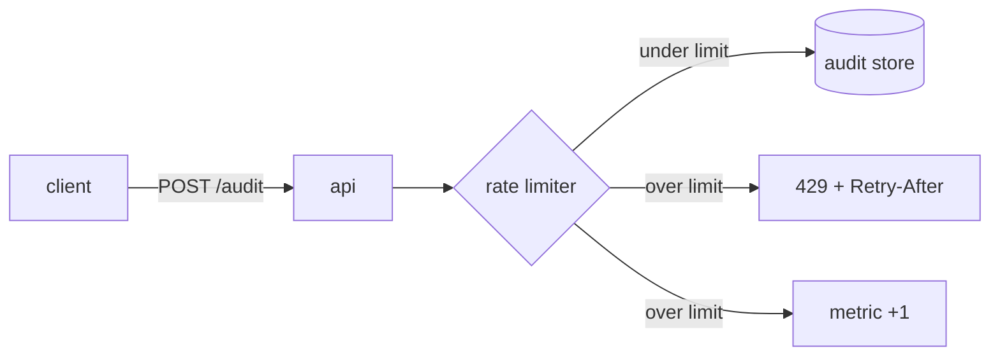

# Ticket template — worked examples

## Blank template

```markdown
## Problem
<1 to 3 sentences. What is wrong or missing. Why it matters now.>

## Scope

### In
- <testable bullet>

### Not in this ticket
- <explicit exclusion>

## Acceptance criteria
- [ ] <observable outcome>

## Test plan
1. <step>
2. <step>
3. <expected result>

## Diagram
<only when a flow, state change, or sequence is involved>
```

## Example 1 — GitHub, with Mermaid

```markdown
## Problem
The `/audit` endpoint has no rate limit. One client sent 40,000 requests in
5 minutes on 2026-07-30 and the audit store fell behind by 12 minutes. Alerts
were late as a result.

## Scope

### In
- Add a per-API-key rate limit to `POST /audit`.
- Return `429` with a `Retry-After` header when the limit is exceeded.
- Emit a metric for every rejected request.

### Not in this ticket
- Rate limits on any other endpoint.
- A per-tenant quota system.
- Changes to the audit store write path.
- A configuration UI for the limit.

## Acceptance criteria
- [ ] A key that sends more than 100 requests in 60 seconds gets `429`.
- [ ] The `429` response carries a `Retry-After` header in seconds.
- [ ] A request under the limit still returns `201` with the same body as today.
- [ ] The counter `audit_ratelimit_rejected_total` increases on each rejection.
- [ ] The limit value is read from config, not hard-coded.

## Test plan
1. Set the limit to 5 per 60 seconds in local config.
2. Send 6 requests to `POST /audit` with the same key inside 10 seconds.
3. Requests 1 to 5 return `201`. Request 6 returns `429` with `Retry-After`.
4. Send 1 request with a second key. It returns `201`.
5. Check `/metrics` shows `audit_ratelimit_rejected_total 1`.

## Diagram


```

## Example 2 — Jira, with ASCII

Jira does not render Mermaid. Put the diagram in a `{code}` block.

```
h2. Problem
Session tokens do not expire. A stolen token stays valid forever.

h2. Scope

h3. In
* Add a 24 hour expiry to every new session token.
* Reject an expired token with 401.

h3. Not in this ticket
* Refresh tokens.
* Existing tokens already issued. They stay valid.
* Any change to the login page.

h2. Acceptance criteria
* (/) A token older than 24 hours returns 401 on any protected route.
* (/) A token younger than 24 hours works as it does today.
* (/) The 401 body says {{"token expired"}}.

h2. Test plan
# Log in and copy the token.
# Call a protected route. It returns 200.
# Set the system clock forward by 25 hours.
# Call the same route. It returns 401 with "token expired".

h2. Diagram
{code}
  request ──▶ auth middleware
                   │
                   ├─ no token ────────▶ 401 "missing token"
                   ├─ issued > 24h ago ▶ 401 "token expired"
                   └─ valid ───────────▶ handler
{code}
```

## Acceptance criteria — good and bad

| Bad (implementation) | Good (observable) |
|---|---|
| Add a null check in `parseUser` | A request with no `user` field returns 400 |
| Refactor the retry helper | A failed upload retries 3 times, then reports the error |
| Use Redis for the cache | A repeated read within 60 seconds does not hit the database |
| Improve performance | The p95 for `GET /list` is under 200 ms with 1000 rows |

## Out-of-scope list — how to fill it

Ask: what would a reader assume is included? Exclude that by name.

For a rate limit ticket, a reader assumes:
- other endpoints get limits too → exclude
- there is a way to configure it per tenant → exclude
- the dashboard shows rejections → exclude

Three lines. Each one saves a review round.
